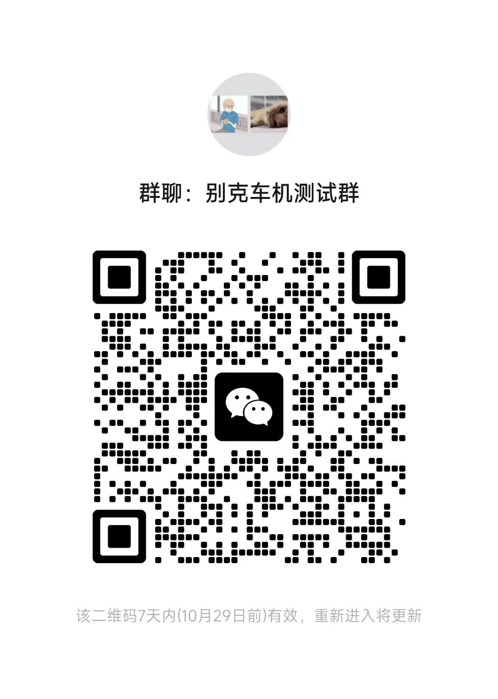

<div align="center">

# 🐢 龟壳 · TurtleShell

**把 Android 原生车联带到无线 CarPlay 车机上。**

复用手机上的车联界面，让导航、音乐和触摸操作延伸到车机。

[原厂组件](components/README.md) · [下载与版本](https://github.com/mrdong916/TurtleShell-Guide/releases) · [安装连接](#安装与连接) · [兼容情况](#兼容与实测) · [加入交流群](#加入交流群) · [支持项目](#支持项目) · [问题反馈](https://github.com/mrdong916/TurtleShell-Guide/issues)

</div>

---

## 项目介绍

本仓库提供龟壳公开使用指南、原厂车联组件下载索引，以及进群和打赏二维码，不包含应用源码。原厂 APK 保存在本仓库 Releases，按厂商目录索引。

龟壳是一个实验性的 Android **无线 CarPlay 发送端**。它连接手机原生车联能力，将画面和支持的媒体声音传到车机，并把车机触摸、媒体按键传回手机。

项目基于 [CarDeck](https://github.com/mrdong916/cardeck) 的发送协议，结合 [Tesla-CarWith-Box](https://github.com/VictorHall6055/Tesla-CarWith-Box) 的原生车联接入思路，提供 CarWith 与公共 CarLife 两类来源。同一个主 App 可选择 Root 或非 Root 权限方式。

```text
手机原生车联（CarWith / 可用的 CarLife 来源）
                    ↓
                  龟壳
                    ⇅  画面、声音、触摸与媒体控制
        无线 CarPlay 车机 / DiPlay 测试台
```

> 本项目为个人开发的非官方实验性软件，与 Apple、小米及任何汽车制造商均无关联，未获相关厂商授权或认证，也不是 MFi 认证产品。请在停车状态下完成安装、配对和调试。完整使用与隐私说明请在应用内查看。

## 当前状态

本文对应的测试版本为 **0.6.32-video-test**（2026-10-22），属于单 APK 实验分支。291 项单元测试、构建、lint、架构及签名检查通过；本版尚未安装或实机验收，下载页以实际发布记录为准。

所有来源请求 **1420 × 480** 内容尺寸，传输画布仍按车机协商。小米 17 的 0.6.31 日志确认 Hook 尺寸正确，CarLife 被原厂已存 720p 覆盖；本版加入原厂设置引导、首页目标/实发码率与尺寸显示，并对首帧前解码队列拥塞采用有界等待。原厂实际尺寸仍须保存设置后实测确认。

## 主要功能

- **原生车联界面**：接入手机已有的 CarWith 或可用 CarLife 来源，保留原厂导航、音乐等交互。
- **无线投屏与控制**：向兼容的无线 CarPlay 接收端发送画面、媒体音频，接收触摸及媒体按键。
- **三条接入路径**：CarWith Root + Hook、CarWith 非 Root + Shizuku、公共 CarLife 普通权限通道，按设备条件选择。
- **行程管理**：CarWith 支持区分“断开投屏”和“结束行程”，普通断开尽量保留原生导航；公共 CarLife 不承诺导航续接。
- **画面与声音设置**：提供码率和音频缓存选项；CarWith 双指手势已有测试台实测，公共 CarLife 当前仅支持单指。
- **诊断与反馈**：按需开启日志、查看环境并导出诊断 ZIP，不自动上传。
- **测试台兼容**：可使用另一台运行 DiPlay 的 Android 设备验证连接链路。

具体表现取决于手机 ROM、原厂车联组件及接收端，已实现的功能不代表所有设备均已验证。

## 下载与准备

已收录 **11 个原厂组件 APK**，包括 CarWith **3.0.1、3.8.3、4.0.6**，以及小米、OPPO、vivo、荣耀、三星各自的 CarLife 定制版。

| 手机 / ROM 家族 | 组件目录 |
| --- | --- |
| 小米 / 红米（含小米 17、K70 Pro 提取样本） | [CarWith 与小米 CarLife](components/xiaomi-redmi/README.md) |
| OPPO / 一加 | [Car+、CarLink 与 OPPO CarLife](components/oppo-oneplus/README.md) |
| vivo / iQOO 候选 | [vivo CarLife](components/vivo-iqoo/README.md) |
| 荣耀 | [荣耀 CarLife](components/honor/README.md) |
| 三星 | [三星车联与三星 CarLife](components/samsung/README.md) |

下载链接、真实包名、版本和 SHA-256 见各目录或 [组件总目录](components/README.md)。这是原厂组件归档，**不代表所有机型已支持，也不是跨品牌通用安装包**。龟壳主 APK 与配套 Hook 的发布情况另见 [Releases](https://github.com/mrdong916/TurtleShell-Guide/releases)。

### 基本条件

- **Android 12 及以上**：这是当前 APK 的最低安装要求，并非全部系统版本的兼容承诺；主要开发环境为 Android 16 / HyperOS。
- **接收端**：支持无线 CarPlay 的车机，或另一台运行 [DiPlay](https://github.com/shihabal3amri/DiPlay/releases) 的 Android 设备。
- **手机车联组件**：具备所选路径需要的原厂应用和服务。安装龟壳不会自动为手机补齐厂商车联能力。
- 开启蓝牙、Wi-Fi，按页面提示授予附近设备、通知等所需权限；首次入网可能需要确认系统弹窗。

### 选择连接方式

| 连接方式 | 适用条件 | 需要安装 / 准备 | 当前边界 |
| --- | --- | --- | --- |
| **CarWith Hook · Root** | 已有 Root 的小米 / 红米候选设备 | 龟壳主 APK、CarWith、LSPosed、配套 **Hook 0.4.4** | 无需 Shizuku；小米 17 旧版本已有实测，当前 Hook 待回归 |
| **CarWith native · 非 Root** | 具有可用 CarWith / 小米 CarLife 的设备 | 龟壳主 APK、原厂组件、[Shizuku](https://shizuku.rikka.app/)、小米“USB 调试（安全设置）” | 镜像、输入和音频采集仍需 Shizuku |
| **公共 CarLife · 非 Root** | 具有可用原厂 CarLife 入口 / 服务的设备 | 龟壳主 APK、原厂车联组件、普通应用权限 | 无需 Root / Shizuku；可能需手动准备原厂服务、填写真实蓝牙地址 |

“单 APK”表示接收能力已并入龟壳主 App。**非 Root 两条路径不再安装旧独立接收器**；Root 的 LSPosed Hook 仍需单独安装。旧接收器保留作研发对照，请避免与内置接收服务同时运行。

CarWith 推荐参考版本为 **3.8.3-20260203**，小米 CarLife 为 **8.6.6**；CarWith 4.0.6 已开展适配。龟壳不按第三方应用版本号拦截，仍会检查真实入口、权限、显示及音视频能力。只有本项目配套 Hook 要求版本匹配。

## 安装与连接

1. **安装并选择通道**：安装主 APK，阅读使用声明，在“设置 → 连接准备”选择来源与权限方式。切换模式前须先结束当前连接及保留的行程。
2. **完成对应准备**：
   - Root：安装配套 Hook，在 LSPosed 启用并勾选 **CarWith（`com.miui.carlink`）**，按提示授予龟壳 Root 权限。
   - CarWith native：启动 Shizuku 并授权龟壳；小米设备开启“USB 调试（安全设置）”。手机重启后按 Shizuku 提示恢复服务。
   - 公共 CarLife：完成原厂车联授权，必要时手动进入无线等待页。若无法自动读取蓝牙地址，填写系统中**本手机的真实蓝牙地址**，不要填写车机或 Wi-Fi 地址。
3. **准备接收端**：实车打开无线 CarPlay，按系统提示完成蓝牙配对和目标 Wi-Fi 连接。DiPlay 测试台先完成两台手机蓝牙配对，并让两台设备接入同一 Wi-Fi，或按 DiPlay 提示使用热点。
4. **选择目标并连接**：在龟壳首页选择目标设备、发起连接。原厂权限、服务条款及系统网络弹窗需手动确认；等到实际画面、声音和触摸可用后再判断连接成功。
5. **按需断开或结束行程**：“断开投屏”停止传输，CarWith 路径尽量保留原生行程；“结束行程”释放原生会话。保留行程可能继续耗电、定位与联网，到达后请结束行程。

普通权限 CarLife 退出后，系统音乐 / 通话蓝牙连接可能仍保留，必要时在系统蓝牙设置中断开当前车机。不要将 Root 路径已验证的自动断开行为视为普通权限路径的保证。


## 兼容与实测

以下记录均对应特定设备和版本，**不是全品牌支持清单，也不代表当前测试版本已通过回归**。

| 路径 / 环境 | 已确认结果 | 尚未覆盖 |
| --- | --- | --- |
| 小米 17 Root → 别克实车，0.6.18 / 0.6.19 | 自动显示、触摸、声音、方向盘切歌、主动断开重连；退出后 iPhone 可重新接入 | 当前版本回归、长期 / 快速重连、更多车型 |
| 小米 17 Root → K70 DiPlay，0.6.23 | 画面、音乐、双指缩放、缓存设置切换与多轮重连 | 当前 Hook 0.4.4 及实车回归 |
| K70 CarWith native → 小米 17 DiPlay，0.6.28 | 内置接收、声音、单指与双指缩放由用户确认 | 长时运行、实车、保留导航重连 |
| K70 普通权限 CarLife → 小米 17 DiPlay，0.6.28 | 隔离 Root / Shizuku 后出图、单指打开地图、非零 PCM、一次退出重连 | 音频听感、导航播报、实车、其他品牌 |
| vivo / iQOO、OPPO / 一加、三星的 CarLife 辅助路径 | 已接入部分明确入口或手动准备流程 | 完整音视频与控制待实机验证；vivo 已有 Wi-Fi 未接通报告 |
| 荣耀、华为 HiCar、魅族 Flyme Link | 方案目录预留 | 尚未完成实际来源接入 |


### 已知限制

- 当前面向**无线 CarPlay**；有线 USB CarPlay 尚未支持。
- 公共 CarLife 当前仅转发单指触摸，不支持双指缩放；电话、车机麦克风和完整双向通话尚未接管。
- 原厂可能不接受请求尺寸；当前统一请求 1420 × 480，实际结果以页面与日志为准。大尺寸传输画布或高分辨率车机面板不等于更高清的原生内容。
- 手机重启、系统清理、原厂应用退出、权限撤销或更新可能导致行程无法恢复；保留行程不是路线备份。
- 原厂应用存在、入口启动成功、网络已连接或 PCM 非零，均不能单独代表完整投屏成功。
- 其他品牌、长期温升、锁屏及复杂网络环境仍需验证。vivo 的 Wi-Fi 问题尚未确认解决，不能将新版容错视为实车修复结论。

## 问题反馈

可在 [GitHub Issues](https://github.com/mrdong916/TurtleShell-Guide/issues) 或下方交流群反馈。建议提供：

- 手机型号、Android / ROM 版本、龟壳版本。
- 所选通道、Root / Shizuku 状态及原厂车联组件版本。
- 车机型号或 DiPlay 版本、连接方式、复现步骤与大致时间。
- 实际画面、触摸、声音分别是否正常；如已开启诊断，可附导出的日志 ZIP。

日志入口为“设置 → 诊断与反馈”。**先开启日志，再复现并导出**；关闭期间及已被滚动清除的记录无法补录。分享前检查是否包含个人信息，应用不会自动上传。

## 加入交流群

欢迎加入微信 **「别克车机测试群」**，交流安装使用、兼容测试和问题排查。

<p align="center">
  <a href="docs/images/wechat-group.jpg">
    
  </a>
</p>

<p align="center">使用微信扫码进群，点击图片可查看原图。</p>

> 图片标注二维码在 **2026 年 10 月 29 日前有效**。过期后请查看仓库更新的二维码；若尚未更新，可通过 Issues 提醒维护者。

## 支持项目

如果龟壳对你有帮助，欢迎给项目点一个 ⭐ Star，或通过微信自愿打赏，支持后续开发与设备测试。感谢每一份反馈和支持。

<p align="center">
  <a href="docs/images/wechat-donate.jpg">
    
  </a>
</p>

<p align="center">微信扫码打赏 · 自愿支持，量力而行</p>

打赏不作为功能解锁条件，也不构成对特定设备兼容性或适配进度的承诺。
